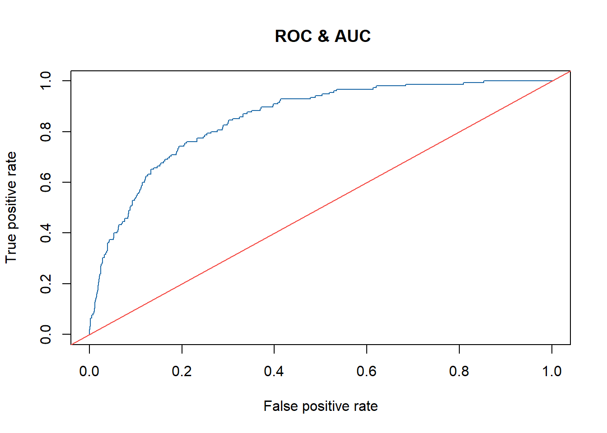

# Statistical Modelling in R: Housing Prices & Bank Marketing

Two academic case studies applying **multiple linear regression** and
**logistic regression** to housing prices and term-deposit subscriptions.
The workflow covers exploratory data analysis, model diagnostics and evaluation
on held-out observations.

**Authors:** Francesco Esposito · Claudio Raffaele Salerno · Davide Gaito  
**Original project:** Statistics for Finance and Insurance, 21 May 2024  
**Portfolio revision:** October 2026  
**Tools:** R, R Markdown, ggplot2, caret, ROCR, lmtest, car.  
**Analysis narrative:** Italian; repository overview: English.

## Case studies

| Case study | Data | Objective and methods |
| --- | --- | --- |
| Housing prices | 4,548 observations; 5 predictors and a price target | Model price associations using multiple linear regression; examine reduced specifications, residuals, influential observations and model assumptions |
| Bank marketing | 4,521 observations; 7 predictors and a binary target | Estimate subscription probabilities after customer contact using logistic regression; evaluate classification and ranking performance |

Neither supplied dataset has missing entries. The bank dataset contains
4,000 non-subscriptions and 521 subscriptions (11.52% positive class).

## Results from the revised analysis

The following values were checked against the user-rendered
[`analysis.html`](reports/analysis.html), produced with **R 4.5.2 on Windows 11**.
They refer to the revised analysis, not the historical PDF.

### Housing prices

The model in original price units retains area income, house age, number of
rooms and area population. The split uses seed 500: 3,178 training rows and
1,370 test rows.

| Measure | Result | Evaluation sample |
| --- | --- | --- |
| Adjusted R² | 0.9175 | Training |
| R² | 0.9213 | Test |
| RMSE | $98,700.97 | Test |
| MAE | $79,196.78 | Test |

Diagnostics include residual plots, Cook's distance, VIF, Breusch–Pagan and an
auxiliary White test. A square-root model after removing influential training
observations is retained as an exploratory sensitivity analysis. Its fit
statistics are on a different response scale and are not directly compared
with the dollar-scale model above.

### Bank marketing

The reduced logistic model retains age, contact duration, campaign contacts,
days since a prior contact and number of previous contacts. The independent
split uses seed 501: 3,164 training rows and 1,357 test rows.

| Test measure | Result |
| --- | --- |
| ROC-AUC | 0.8518 |
| Accuracy, threshold 0.5 | 89.09% |
| Always predict non-subscription: accuracy | 88.58% |
| Precision, subscription as positive class | 56.36% |
| Recall, subscription as positive class | 20.00% |
| Specificity, non-subscription class | 98.00% |

The confusion matrix contains TN = 1,178, FP = 24, FN = 124 and TP = 31.
Although the model ranks outcomes better than chance, the 0.5 threshold
identifies only one fifth of actual subscriptions. Accuracy exceeds the
always-negative baseline by about 0.52 percentage points. ROC-AUC alone does
not establish probability calibration or business value.



**Use-case boundary:** contact duration is known after the call. This analysis
therefore evaluates a **post-contact** model. Pre-call customer targeting
requires a separate model excluding duration, followed by fresh evaluation.
The target is term-deposit subscription, not credit default.

## Repository contents

| File | Purpose |
| --- | --- |
| [`analysis.Rmd`](analysis.Rmd) | Revised analysis source |
| [`reports/analysis.html`](reports/analysis.html) | Rendered analysis with outputs, plots and session information |
| [`reports/metrics.json`](reports/metrics.json) | Machine-readable summary of the checked results |
| [`data/`](data/) | Supplied educational datasets, with standardized filenames |
| [`data/README.md`](data/README.md) | Column descriptions and provenance notes |
| [`scripts/install_packages.R`](scripts/install_packages.R) | Installs missing dependencies |
| [`scripts/render.R`](scripts/render.R) | Renders HTML by default, or PDF on request |
| [`reports/original_report.pdf`](reports/original_report.pdf) | Unmodified historical report |
| [`reports/original_analysis.Rmd`](reports/original_analysis.Rmd) | Unmodified historical source; archival only |
| [`docs/revision-notes.md`](docs/revision-notes.md) | Corrections, validation and remaining limitations |

## Run locally

Install R and optionally RStudio, then open
`statistics-finance-insurance-r.Rproj`. From the repository root:

```sh
Rscript scripts/install_packages.R
Rscript scripts/render.R
```

The output is `reports/analysis.html`. Pandoc is required; RStudio normally
supplies it. PDF output additionally requires LaTeX:

```sh
Rscript scripts/render.R pdf
```

From the RStudio Console, the equivalent HTML workflow is:

```r
source("scripts/install_packages.R")
rmarkdown::render(
  "analysis.Rmd",
  output_format = "html_document",
  output_dir = "reports"
)
```

Fixed seeds make the splits repeatable within a compatible R environment.
Package versions are recorded in the rendered report's `sessionInfo()` but
are not locked. The supplied HTML was reviewed; the preparation environment
did not independently rerun R.

## Original versus revised results

The original banking model reported an AUC of 0.8312. The revised analysis
uses an independent bank seed and reports 0.8518; these come from different
holdout splits and do **not** establish a like-for-like performance improvement.
The revision also corrects the cleaned-data model and positive-class metric
interpretation. Historical files preserve their original content and errors.

## Skills demonstrated

Exploratory data analysis · statistical inference · regression modelling ·
model diagnostics · holdout evaluation · imbalanced classification ·
R Markdown reporting.

## Authorship and data provenance

This is a three-author academic project included in Claudio Raffaele Salerno's
portfolio. The original authorship is preserved; individual contributions are
not specified in the supplied materials.

The report describes the bank file as a subset of a Portuguese marketing
campaign and the housing file as US housing data. Primary-source URLs,
preprocessing histories and dataset licenses are not included in the supplied
materials. No precise dataset origin or open-source license is asserted.
